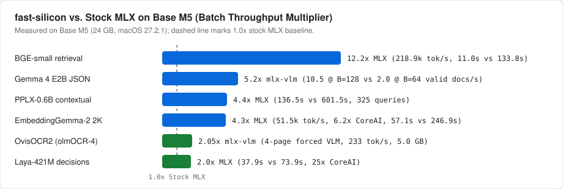

# fast-silicon

Local Apple Silicon engines for bulk embeddings, document OCR, decision scoring, and schema-constrained JSON extraction. Built to replace cloud ML API bills at batch scale by running the Metal GPU and 16-core Apple Neural Engine (ANE) concurrently, with zero telemetry, no account, and 100% offline execution after weight download.

<picture>
  <source media="(prefers-color-scheme: dark)" srcset="docs/assets/throughput_dark.svg">
  <source media="(prefers-color-scheme: light)" srcset="docs/assets/throughput_light.svg">
  
</picture>

## Requirements

- **Supported:** Apple Silicon Macs (verified on 48 GB M4 Pro macOS 26.6 and 24 GB base M5 macOS 27.2.1), macOS 15+ for Core ML ANE bundles and native runners (`macOS 14+` for GPU-only MLX), Python 3.12+, and `uv`.
- **Unsupported:** Windows, Linux, and Intel Macs for Metal GPU / Core ML ANE / Apple Vision execution (`fast-shared` CPU vector & BM25 retrieval via `cpu_kernels`, `CompactRetrievalIndex`, and `BM25Index` also runs cross-platform on Linux/x86_64/ARM64 via `cpu_backend`). Xcode Command Line Tools are required to compile native ANE `.dylib` runners (`make -C packages/fast-bge-small native`, optional when passing `default_mode="gpu"`); inference needs neither `torch` nor `transformers`.

## Quickstart (`fast-bge-small`, ~0.15-0.35 GB prebuilt download)

```bash
git clone https://github.com/mikewolfd/fast-silicon
cd fast-silicon
uv sync --python 3.13 --package fast-bge-small --inexact
make -C packages/fast-bge-small native
.venv/bin/bge-small setup-weights
```

```python
from fast_bge_small import FastBgeSmall

passages = [
    "Ocean currents carry heat from the tropics toward the poles.",
    "A piano has 88 keys.",
]
engine = FastBgeSmall(default_mode="hetero")
query = engine.encode_texts("How does heat move through the ocean?", add_query_prefix=True)
vectors = engine.encode_texts(passages)
print(passages[int((vectors @ query).argmax())])
```

To install multiple packages or build tools, run `uv sync --extra dev --extra extract --extra build` and preview weight downloads (~36-38 GB full across all 8 model packages, or ~25.6 GB with `--skip-test-extras`) with `.venv/bin/python scripts/setup_all.py --dry-run`.

## How it works

Stock MLX uses the Metal GPU and leaves the 16-core ANE idle, while Core ML uses the ANE and leaves the GPU idle. Most local runners are also tuned for single-user `B=1` chat instead of offline batch ETL jobs that share the same system prompt and JSON schema across thousands of rows.

```text
  Variable-length batch (sorted by token count)
     ├── longest sequences ──▶ Metal GPU (packed varlen / custom kernels) ──┐
     │                                                                      ├──▶ merged outputs in input order
     └── shortest sequences ◀─ 16-core ANE (multifunction Core ML ring)  ───┘
```

Pair that dual-accelerator scheduler with zero-padding sequence packing, shared system-prompt KV caches (`PrefixTree` / `Hydragen v2`), INT8/binary vector indexes, and schema-enforced fast-forward decoding, and throughput scales cleanly inside unified memory.

## Packages

| Workload | Package | What you get | Prebuilt download |
| --- | --- | --- | --- |
| Search short English passages | [`fast-bge-small`](packages/fast-bge-small) | 384d vectors; **0.79 ms** warm query (M5; `0.49 ms` M4 Pro), **1.22-3.83x** batched `Q>=8` query routing, **172.9-218.9k tok/s** bulk (**12.2x** stock MLX; M5 NAX `32x64` MPP FA). | ~0.15-0.35 GB |
| Index 2K passages & page images | [`fast-embeddinggemma-2`](packages/fast-embeddinggemma-2) | Up to 2,048 tokens (128-768d); **31.6-51.5k tok/s** (**4.3-4.8x** MLX, **3.3x** Core ML), **16.2 img/s** lazy vision, `1.73-1.93x` M5 SWA at `S>=128`. | ~0.30-0.65 GB |
| Contextual passage & 32K search | [`fast-pplx`](packages/fast-pplx) | Contextual 4K chunking lifts legal nDCG from 0.359 (isolated) to 0.703 (`4.4x` stock), **29.9k tok/s** M5 `hetero2`, `w512_ov64` `MaxSim` `+8.33 pp` 32K recall. | ~1.8-2.4 GB |
| Score decisions & rerank choices | [`fast-decision-models`](packages/fast-decision-models) | 100% Pure-ANE 421M `Laya` (**4.37 ms/q** / **228.6 q/s** M5 hetero, **77.0 s** ANE across 1,400 items), `Kev-0.8B/4B` prefix cache, `GenRMScorer` (**0.8993** `RAGTruth` AUROC, **0.564** `RewardBench-2`), 5-fold OOF / OOS calibration, and 2/3-tier `DecisionCascadeScorer` (`0.6259` `CLINC` OOS F1, `0.0701` `RAGTruth` ECE). | ~1.3-4.9 GB |
| High-throughput JSON & tools (2B) | [`fast-gemma4`](packages/fast-gemma4) | **1,291 tok/s** (`6.44 docs/s`) monorepo / **10.5 valid docs/s** @ `B=128` (**5.2x** `mlx-vlm`), **1.59x** GPU top-k sampled decode, bounded `<\|channel>` thinking (**0.7404** `MMLU-Redux`, `+25.96 pp`), **1.87x** multimodal rolling over `B=1 MTP`, and packed single-mask `QLoRA`. | ~4.2-5.4 GB (~10.4-17.0 GB with test extras) |
| Reasoning, tools & 16K JSON (4B/9B) | [`fast-qwen3`](packages/fast-qwen3) | Hybrid GDN + slot-indexed Flash-Decode/GDN rolling (**503.5 tok/s** @ `B=64`, `1.88x` Skew4096 on `9B-OptiQ`), 4-bit QuaRot KV, **300/300** `4B` Cat-4 (`0.8925`), `K=4` self-consistency reasoning (`0.86` `MATH-500(50)` vs `0.66` greedy; `2.49x` GPU top-k / `4.05x` rolling `0.82`), and `9B-OptiQ` Tier-1 option (`0.6805` Cat-3, `13.3-14.3 GB` peak on M5). | ~3.3 GB |
| Extract Markdown & tables from PDFs | [`fast-ocr`](packages/fast-ocr) | Clean PDF bypass (**139-220 pp/s**), Tier-2 header/footer cleanup (`0.6402` olmOCR M5, `headers_footers 7/12`), `3.15M` ViT cap, `8192`-tok `OmniDoc` **`0.7437`** (`24/24`), and opt-in `v7final` GFM preset (`0.7472` OmniDoc `24/24`, `1.51x` FinTabNet). | ~2.60 GB |
| Batch 20B MXFP4 MoE generation | [`fast-gpt-oss`](packages/fast-gpt-oss) | `gpt-oss-20b` across **24-48 GB+ Macs** (**168.2 tok/s** @ B=16 on 24 GB Base M5 in `12.9-13.8 GB`; M5 Hot-MPP **1.71x** @ B=8, **444.1 tok/s** @ B=128 on 48 GB). | ~12.10 GB |
| Shared runtime & compact index | [`fast-shared`](packages/fast-shared) | Unified `hw_check` dispatch, cross-platform `cpu_kernels` (`neon`/`avx512`/`avx2`/`portable_cpp`), `CompactRetrievalIndex` (**0.30 ms/q** `binary_int8` / **0.75 ms/q** `int8` @ 100K x 1024d, **16.4x** `Q=16`, **14.9x** `MaxSim`), gated BMW `BM25Index` (**10.8-13.2x**, **6.05x** hybrid), `HybridRetrievalPipeline` (`0.7569` `LegalBench` contextual `MaxSim` / `0.7803` w/ `GenRM`), 1-pass GPU `argmax`, GPU top-k sampling, self-consistency, `PrefixTree`, and Parquet ETL. | - |

## Headline benchmarks (Base M5 24 GB, with M4 Pro 48 GB reference)

All runs execute locally after warmup with deterministic accuracy verification on pinned public benchmarks. Base M5 values reflect the quiescent `d9f65a3` 4-suite verification run ([docs/benchmarks/m5-suite-20261126.json](docs/benchmarks/m5-suite-20261126.json)); M4 Pro retains the prior verified reference run. See [docs/BENCHMARKS.md](docs/BENCHMARKS.md) for datasets, stock configs, hardware ceilings, and CLI reproducers.

| Workload (metric) | Base M5 (`24 GB`, headline `d9f65a3`) | M4 Pro (`48 GB` ref) | Baseline comparison |
| --- | --- | --- | --- |
| **BGE-small retrieval (`325` queries, FP16)** | **218.9k tok/s** (`10.99 s`, `14.01` EOT, `1.06 GB`) | **187.2k tok/s** (`12.2 s`, `1.55 GB`) | **12.2x** (M5 `10.99s` vs `133.8s`) / **9.6x** (M4 Pro) stock MLX |
| **EmbeddingGemma-2 (`2K` bulk / `325`-`500`q)** | **51.5k tok/s** bulk (`325`q: `47.2 s`, `2.74 GB`, `0.5182`; `500`q: `57.1 s`) | **38.5k tok/s** (`500`q: `74.9 s`, `2.49 GB`) | **4.3-4.8x** MLX (`500`q), **3.3x** Core ML, **6.2x** CoreAI |
| **Contextual PPLX (`325` queries, FP16/W8A16)** | **29.9k tok/s** `hetero2` (`95.5 s`, `2.29 GB`, `0.5297` Tier-1; 4K: `0.7244`, `136.5 s`) | **0.7241 score** (`167.3 s`, `1.97 GB`) | **4.4x** (M5) / **4.3x** (M4 Pro) `pplx-context-mlx` (matched 4K) |
| **Laya-421M scoring (`1,400` items, W8A16/BF16)** | **228.6 q/s** (`4.37 ms/q`) hetero (`37.9 s`) / **77.0 s** ANE (`0.5079`, `1.58 GB`) | **59.3 s** hetero (`3.30 GB`) / **133.1 s** ANE (`1.52 GB`) | **2.0x** MLX (hetero) / **12x** ANE to **25x** hetero vs CoreAI |
| **Gemma 4 E2B extraction (4-bit W, INT8 KV)** | **1,291 tok/s** (`6.44 docs/s`) monorepo / **10.5 valid docs/s** @ `B=128` (`300/300` Cat-4, `0.8836`, `63.5 s`, `4.98 GB`) | **8.8 valid docs/s** (ANE+GPU, `6.28 GB` MLX) | **5.2x** stock `mlx-vlm` valid rate (`10.5` @ `B=128` vs `2.02` @ `B=64`) |
| **Qwen 3.5 4B JSON + tools (`300` tasks, OptiQ 4-bit / auto KV)** | **0.8925** (`300/300` valid, `0.886` EOT, `302.2 s`, `4.72 GB`) | **0.8930** (`299/300` valid, `4.99 GB`) | **1.4-1.5x** scored throughput vs unconstrained MLX |
| **Document OCR (`96` pages, OvisOCR2 8-bit auto router)** | `0.613` olmOCR / `0.878` FinTab (`31.1 s`, `433.8` dec tok/s) / `0.687` Omni (`PASS` 3/3) | `0.616` olmOCR / `0.894` FinTab / `0.657` Omni | **1.4-2.05x** forced VLM (4-page); **3.5x** mixed PDF splice |
| **GPT-OSS-20B (`MXFP4`, batched)** | **168.2 tok/s** (`0.742 docs/s`) @ B=16 (`12.90 GB` MLX / `13.78 GB` OS; `129.8 tok/s` @ B=8) | **444.1 tok/s** @ B=128 (`15.96 GB` MLX / `16.67 GB` peak) | Capacity sweep on 24-48 GB+ Macs (`3.35x` `B=16` vs `B=1` on M5; auto-clamps on 16 GB) |

- **Sub-millisecond cross-platform CPU search & BM25:** `CompactRetrievalIndex` and `BM25Index` run multi-core C++17 SIMD kernels across Apple Silicon and non-Apple CPUs (`neon`, `avx512` VNNI+VPOPCNTDQ, `avx2`, `portable_cpp`, plus `numpy` fallback) via `cpu_backend`. On `100K x 1024d`, `CompactRetrievalIndex` reaches **0.30 ms/query** (`binary_int8`) and **0.75 ms/query** (`int8`, `3.86x` `Q=1` / **`16.43x`** `Q=16`), fused multi-vector `MaxSim` runs up to **`14.86x`** faster, selective-anchor-gated Block-Max WAND `BM25Index` runs **`10.79x-13.16x`** faster (**`6.05x`** stacked `Q=16` hybrid), and `portable_cpp` runs **`11x-55x`** faster than NumPy on non-Apple hosts ([CPU query optimization details](docs/BENCHMARKS.md#186-cross-platform-cpu-retrieval--query-acceleration-cpu-query-opt-20261127) · [M4 Pro + cross-ISA receipt](docs/benchmarks/m4-cpu-query-opt-20261127.json)).
- **Local post-training (Base M5 `d9f65a3`):** Packed `ModernBERT` (`Packed-512`) fine-tuning hits **`33.3 items/s`** (**`42.4 items/s`** cached `L0..17`, **`1.32x`** stock `25.3 items/s`, `5.64 GB` peak), `QLoRA` at `ckpt=1024` runs at **`101.3` packed / `109.8` unpacked supervised tok/s** and **`1,098` vs `727` logical tok/s (`1.51x`)** with shared system-prompt KV reuse (`7.26-9.64 GB` peak on M5; `546` packed / `1,385` shared-prefix logical tok/s on 48 GB M4 Pro), and disaggregated `GRPO` runs `Gemma 4` rollouts on Metal GPU concurrently with `Laya` critic scoring on the ANE (**`2.26` GRPO / `3.53` BoN rollouts/s** = **`4.50x`** `mlx-vlm` + Kev-8bit on M5, `5.63 GB` peak) ([training benchmarks](docs/BENCHMARKS.md#5-local-training--post-training-qlora-modernbert-grpo)).

## Prebuilt Hugging Face artifacts

Pre-compiled `.mlmodelc` Core ML bundles and pre-quantized MLX checkpoints skip local model compilation:

| Package | Prebuilt Hugging Face repo | Contents |
| --- | --- | --- |
| `fast-decision-models` | [`mikewolfd/laya-typed-decisions-421m-coreml-ane`](https://huggingface.co/mikewolfd/laya-typed-decisions-421m-coreml-ane) | 6-bucket multifunction `laya_typed_w8.mlmodelc` (100% Pure-ANE) + FP16 weights + tokenizer |
| `fast-decision-models` | [`mikewolfd/kev-0.8b-mlx-w8`](https://huggingface.co/mikewolfd/kev-0.8b-mlx-w8) | Pre-merged 8-bit (`g64`) `model_w8.safetensors` (`801 MB`) + original Kev tokenizer |
| `fast-pplx` | [`mikewolfd/pplx-embed-v2-context-0.6b-coreml-ane`](https://huggingface.co/mikewolfd/pplx-embed-v2-context-0.6b-coreml-ane) | 4-stage `W8A16` balanced ANE bundles (`64..512`) + FP16 weights + mmap `embed_tokens` |
| `fast-embeddinggemma-2` | [`mikewolfd/embeddinggemma-2-coreml-ane`](https://huggingface.co/mikewolfd/embeddinggemma-2-coreml-ane) | 9 packed `W8A16` ANE bundles (`32..512`) + 3 CPU-SME bundles + FP16 weights + tokenizer |
| `fast-bge-small` | [`mikewolfd/bge-small-en-v1.5-coreml-ane`](https://huggingface.co/mikewolfd/bge-small-en-v1.5-coreml-ane) | 9 FP16 Pure-ANE buckets (`s16..s512`) + weights + tokenizer |
| `fast-gemma4` | [`mikewolfd/gemma-4-e2b-it-early14-coreml-ane`](https://huggingface.co/mikewolfd/gemma-4-e2b-it-early14-coreml-ane) | `Early14` Core ML ANE prefill bundles (`fp16` + `w8`, `1,326` ANE ops) + `150K` vocab remap |

## Limitations & Non-Goals

- **Single-model RAM vs. standalone Core ML:** Running Metal GPU and ANE together consumes more unified memory than a standalone 8-bit Core ML export (for instance, `3.43 GB` vs. `0.84 GB` on EmbeddingGemma-2). Use `mode="ane"` for minimal RAM when latency allows.
- **Batch HTTP serving:** OpenAI-compatible HTTP servers collect microbatches and return completed responses rather than token-by-token SSE streams.
- **Large-batch 20B memory:** `fast-gpt-oss` runs cleanly on 24 GB Macs (`13.4-14.3 GB` peak, auto-clamped to `B=16`), while large `B=64-128` batch sweeps want 32-48 GB+ RAM. There is no matched-prompt/batch `B=128` stock `mlx-lm` throughput baseline, and on 25 tool tasks the recorded `MXFP4-Q4` run trailed unconstrained `mlx-lm` accuracy (`9/25` vs `14/25`).
- **Grammar lift vs. kernel speed:** On structured JSON benchmarks against unconstrained stock `mlx-lm`/`mlx-vlm`, `llguidance` grammar enforcement eliminates malformed JSON alongside kernel speedups; package READMEs report raw speed and validity separately.
- **Hardware coverage:** Verified continuously on M4 Pro and base M5; M1-M3 Macs work via the same MLX/Core ML paths but are not in our hardware CI matrix.

## Prior Art, Development & License

- **Compared to `mlx-lm` / `mlx-vlm` and `llama.cpp`:** Those excel at general interactive chat and broad GGUF/MLX model coverage; `fast-silicon` targets high-volume Apple Silicon batch pipelines with ANE offloading, shared-prefix KV reuse, and compact retrieval.
- **Compared to public Core ML exports & Apple CoreAI:** Standalone Core ML models save RAM on single models, while `fast-silicon` adds long-context GPU fallback (`2K-32K`), batch work-stealing, and unified Python/Parquet CLIs.
- **Acknowledgments:** [`zm2231/pplx-context-mlx`](https://github.com/zm2231/pplx-context-mlx) (MIT) inspired `fast-pplx` memmap embeddings, tile-aligned slicing, and parity testing. Built on `mlx`, `mlx-lm`, `coremltools`, `llguidance`, `pypdfium2`, and upstream weights from BAAI, Google, Qwen, Perplexity, OpenAI, and ConvAI.

Code is [MIT licensed](LICENSE) (downloaded upstream model weights remain subject to their original licenses). See [CHANGELOG.md](CHANGELOG.md) for release history and [CONTRIBUTING.md](CONTRIBUTING.md) for contributor workflows, sibling repo syncing, and test suites.
